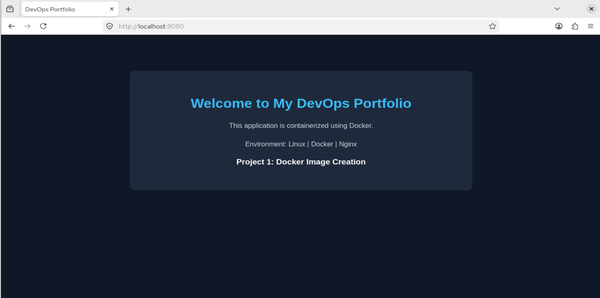

# Docker Image Creation and Security Project
## Project Screenshot


## 1. Project Overview

This project demonstrates how to build, version, run, inspect, and secure Docker images using a static DevOps portfolio website served by Nginx.

The project was developed on Red Hat Enterprise Linux using Docker Engine and Docker Compose.

## 2. Technologies Used

- Red Hat Enterprise Linux 10
- Docker Engine
- Docker Buildx
- Nginx
- Linux CLI
- HTML
- Git and GitHub

## 3. Project Objectives

- Understand Docker image creation.
- Build custom Docker images using Dockerfiles.
- Understand image layers and image history.
- Implement image tagging and versioning.
- Use `.dockerignore` to control build context.
- Run and manage Docker containers.
- Configure port mapping and restart policies.
- Compare standard and unprivileged Nginx images.
- Run containers using a non-root user.
- Use read-only bind mounts for improved security.

## 4. Project Structure

```text
docker-image-project/
├── Dockerfile
├── Dockerfile.secure
├── .dockerignore
├── README.md
├── docs/
├── screenshots/
└── src/
    └── index.html
```

## 5. Docker Image Creation

The original Dockerfile uses the official Nginx Alpine image.

```dockerfile
FROM nginx:alpine
COPY src/ /usr/share/nginx/html/
EXPOSE 80
```

Build the image:

```bash
docker build -t devops-portfolio:v1 .
```

Tag the image:

```bash
docker tag devops-portfolio:v1 devops-portfolio:latest
```

Build version 2:

```bash
docker build -t devops-portfolio:v2 .
```

## 6. Docker Image Inspection

Inspect available images:

```bash
docker images
```

View image history:

```bash
docker history devops-portfolio:v1
docker history devops-portfolio:v2
```

Inspect image configuration:

```bash
docker image inspect devops-portfolio:v1
```

Image layers were compared to understand how changes to application files affect Docker images.

## 7. Docker Ignore

The `.dockerignore` file excludes unnecessary files from the Docker build context.

Examples:

```text
.git
.gitignore
*.log
.env
.env.*
!.env.example
node_modules
__pycache__
*.pyc
.DS_Store
.vscode
.idea
```

This reduces unnecessary build-context data.

## 8. Container Management

The original application was run using:

```bash
docker run -d \
  --name devops-portfolio-web \
  -p 8080:80 \
  --restart unless-stopped \
  devops-portfolio:v1
```

Version 2 was run on port 8081.

Useful container commands:

```bash
docker ps
docker ps -a
docker stop devops-portfolio-web
docker start devops-portfolio-web
docker logs devops-portfolio-web
docker inspect devops-portfolio-web
```

## 9. Docker Port Mapping

The project used these host ports:

| Host Port | Container Port | Purpose |
|---|---|---|
| 8080 | 80 | Original image |
| 8081 | 80 | Version 2 |
| 8082 | 8080 | Unprivileged Nginx test |
| 8083 | 8080 | Custom secure image |

HTTP responses were verified using `curl`.

Example:

```bash
curl -I http://localhost:8080
```

## 10. Docker Security Implementation

### Standard Nginx Image

The original image uses:

```dockerfile
FROM nginx:alpine
```

Its Nginx master process runs as root, while worker processes run as the nginx user.

### Unprivileged Nginx Image

A separate secure Dockerfile was created:

```dockerfile
FROM nginxinc/nginx-unprivileged:alpine
COPY src/ /usr/share/nginx/html/
EXPOSE 8080
```

Build the secure image:

```bash
docker build -f Dockerfile.secure \
  -t devops-portfolio:secure-v1 .
```

Verify its configured user and exposed port:

```bash
docker image inspect devops-portfolio:secure-v1 \
  --format='User: {{.Config.User}} | Exposed Ports: {{json .Config.ExposedPorts}}'
```

The image was configured with UID 101 and port 8080.

### Run the Secure Container

```bash
docker run -d \
  --name devops-portfolio-secure-v1 \
  -p 8083:8080 \
  --restart unless-stopped \
  devops-portfolio:secure-v1
```

Verify running processes:

```bash
docker exec devops-portfolio-secure-v1 ps
```

The Nginx master and worker processes were verified to run as `nginx`, not root.

## 11. Read-Only Bind Mount

A separate unprivileged Nginx container was tested with a read-only bind mount:

```bash
docker run -d \
  --name devops-portfolio-secure \
  -p 8082:8080 \
  --restart unless-stopped \
  -v "$(pwd)/src:/usr/share/nginx/html:ro" \
  nginxinc/nginx-unprivileged:alpine
```

Verify the mount:

```bash
docker inspect devops-portfolio-secure \
  --format '{{range .Mounts}}{{println .Destination "RW=" .RW "Mode=" .Mode}}{{end}}'
```

Expected result:

```text
/usr/share/nginx/html RW= false Mode= ro
```

A write test was performed:

```bash
docker exec devops-portfolio-secure \
  touch /usr/share/nginx/html/test.txt
```

The operation was rejected with `Read-only file system`, confirming the mount was read-only.

## 12. Application Testing

Test the secure image:

```bash
curl -I http://localhost:8083
```

Check application content:

```bash
curl -s http://localhost:8083
```

The application returned HTTP 200 OK and displayed the version 2 portfolio content.

## 13. Security Improvements Demonstrated

- Running Nginx as a non-root user.
- Using an unprivileged Nginx base image.
- Restricting write access with a read-only bind mount.
- Excluding unnecessary files from the build context.
- Verifying container processes and image configuration.

## 14. Project Outcome

Successfully built and tested multiple Docker image versions, inspected image layers, managed containers, configured port mappings, and implemented container security improvements using an unprivileged Nginx image and read-only bind mounts.

## 15. Author

DevOps Practical Project — Project 1  
Repository: `docker-image-project`
